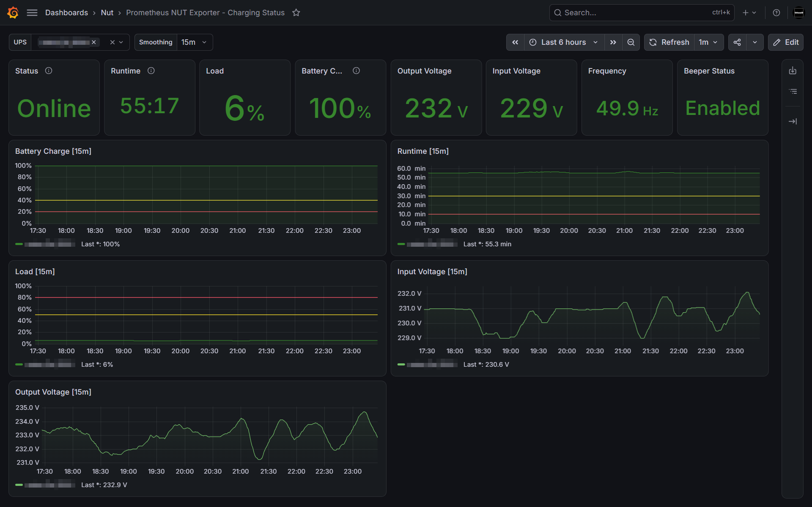

<p align="center"></p>

# Prometheus NUT Exporter (modernized amd64 + arm64 build)

[](https://github.com/ShlomiD83/nut-exporter/actions/workflows/ci.yml)
[](https://hub.docker.com/r/romekd/prometheus-nut-exporter)

**📊 Grafana dashboard:** [Charging Status dashboard](https://github.com/ShlomiD83/nut-exporter/blob/main/dashboards/nut-exporter-charging-status.json) ([download JSON](https://raw.githubusercontent.com/ShlomiD83/nut-exporter/main/dashboards/nut-exporter-charging-status.json)). Import it in Grafana via Dashboards → New → Import, then pick your Prometheus data source.

> **⚠️ IMPORTANT – Grafana plugin required**
>
> The [dashboard](https://github.com/ShlomiD83/nut-exporter/blob/main/dashboards/nut-exporter-charging-status.json) shows UPS runtime as `mm:ss` using the **Dynamic Text** panel plugin. Grafana must have it installed, or the runtime panel will not render. Set this environment variable on the **Grafana** container:
>
> ```
> GF_PLUGINS_PREINSTALL=marcusolsson-dynamictext-panel
> ```
>
> See [Grafana](#grafana) below for a full example.

Fork of [HON95/prometheus-nut-exporter](https://github.com/HON95/prometheus-nut-exporter), published as [`romekd/prometheus-nut-exporter`](https://hub.docker.com/r/romekd/prometheus-nut-exporter) on Docker Hub and [`ghcr.io/shlomid83/nut-exporter`](https://github.com/ShlomiD83/nut-exporter/pkgs/container/nut-exporter) on GitHub Container Registry (same image, same tags).

Differences from upstream:

- Updated to current dependencies (hyper 1.x via hyper-util, tokio 1.5x, env_logger 0.11); unused `chrono`/`url` dependencies removed.
- HTTP server serves both HTTP/1.1 and HTTP/2.
- Fully static musl binary in a `FROM scratch` image (no OS layer), running as UID/GID 5000.
- Image tags: `latest` and a build date tag (`YYYY-MM-DD`), multi-arch for `linux/amd64` and `linux/arm64`. A new image is published only when the code, Cargo files or Dockerfile change (or on a manual CI run); README-only changes just update the Docker Hub description.
- CI runs clippy, an integration test against a mock NUT server, and `cargo audit` (RustSec advisories) on every push and weekly.
- Dependabot opens weekly dependency PRs; they are merged automatically once CI passes, which also publishes a new image.

Configuration, metrics and Prometheus setup are unchanged from upstream and documented below.



A Prometheus/OpenMetrics exporter for uninterruptable power supplies (UPSes) using Network UPS Tools (NUT).

## Usage

### NUT

Set up NUT in server mode and make sure the TCP port (3493 by default) is accessible (without authentication).

If you want to test that it's working, run `telnet <nut-server> 3493` and then `VER`, `LIST UPS` and `LIST VAR <ups>`.

### Docker

Example `docker-compose.yml`:

```yaml
services:
  nut-exporter:
    image: romekd/prometheus-nut-exporter:latest
    container_name: nut-exporter
    restart: unless-stopped
    environment:
      # /metrics is Prometheus' default metrics_path, so no extra scrape config is needed
      HTTP_PATH: /metrics
      RUST_LOG: info
    # HTTP_PORT defaults to 9995
    ports:
      - "9995:9995/tcp"
    # Security hardening
    user: "5000:5000"
    read_only: true
    cap_drop:
      - ALL
    security_opt:
      - no-new-privileges:true
    mem_limit: 64m
    cpus: 0.5
    pids_limit: 64
    logging:
      driver: json-file
      options:
        max-size: "10m"
        max-file: "3"
```

The image is a single static binary on `scratch` (no shell, no OS), so it runs fine as a non-root user with a read-only filesystem and no Linux capabilities. It needs only a few MB of memory; the limits above leave plenty of headroom.

### Prometheus

Example `prometheus.yml`:

```yaml
global:
    scrape_interval: 15s
    scrape_timeout: 10s

scrape_configs:
  - job_name: "nut"
    static_configs:
      # Insert NUT server address here
      - targets: ["nut-server:3493"]
    relabel_configs:
      - source_labels: [__address__]
        target_label: __param_target
      - source_labels: [__param_target]
        target_label: instance
      - target_label: __address__
        # Insert NUT exporter address here
        replacement: nut-exporter:9995
```

In the above example, `nut-exporter:9995` is the address and port of the NUT _exporter_ while `nut-server:3493` is the address and port of the NUT _server_ to query through the exporter.

### Kubernetes Resource Usage

Example container resources requests and limits.
This was done by scraping one NUT server with two UPSes.
Resource usage was observed across 7 days period.
This can be lowered even more but should be sufficient as a starting point.

```yaml
resources:
  limits:
    cpu: "10m"
    memory: "16Mi"
  requests:
    cpu: "1m"
    memory: "8Mi"
```

### Grafana

Dashboard: [`dashboards/nut-exporter-charging-status.json`](https://github.com/ShlomiD83/nut-exporter/blob/main/dashboards/nut-exporter-charging-status.json) ([download JSON](https://raw.githubusercontent.com/ShlomiD83/nut-exporter/main/dashboards/nut-exporter-charging-status.json)). Import it in Grafana (Dashboards → New → Import) and pick your Prometheus data source. It shows UPS status (including a *Charging* state when online below 100%), runtime as `mm:ss`, load, battery charge, input/output voltage, frequency and beeper status.

The original upstream dashboard is [14371](https://grafana.com/grafana/dashboards/14371).

**Required plugin:** the UPS runtime is displayed as `mm:ss` with the [Dynamic Text](https://grafana.com/grafana/plugins/marcusolsson-dynamictext-panel/) panel plugin. Grafana installs it on startup when this environment variable is set on the Grafana container:

```
GF_PLUGINS_PREINSTALL=marcusolsson-dynamictext-panel
```

Docker CLI:

```sh
docker run -d -p 3000:3000 -e GF_PLUGINS_PREINSTALL=marcusolsson-dynamictext-panel grafana/grafana
```

Docker Compose:

```yaml
services:
  grafana:
    image: grafana/grafana
    ports:
      - "3000:3000"
    environment:
      - GF_PLUGINS_PREINSTALL=marcusolsson-dynamictext-panel
```

If you add the variable to an existing Grafana container, recreate the container (e.g. `docker compose up -d grafana`) so it picks up the change.

## Configuration

### Docker Image Versions

Use `latest` for the newest build, or a date tag (e.g. `2026-11-18`) to pin a specific build. Images are multi-arch (`linux/amd64`, `linux/arm64`); Docker pulls the right one automatically. Both `romekd/prometheus-nut-exporter` and `ghcr.io/shlomid83/nut-exporter` carry the same tags.

### Environment Variables

- `RUST_LOG` (defaults to `info`): The log level used by the console/STDOUT. Set to `debug` so show HTTP requests and `trace` to show extensive debugging info.
- `HTTP_ADDRESS` (defaults to `::`): The HTTP server will listen on this IP. Set to `127.0.0.1` or `::1` to only allow local access.
- `HTTP_PORT` (defaults to `9995`): The HTTP server port.
- `HTTP_PATH` (defaults to `nut`): The HTTP server metrics path. You may want to set it to `/metrics` on new setups to avoid extra Prometheus configuration (not changed here due to compatibility).
- `PRINT_METRICS_AND_EXIT` (defaults to `false`): Print a Markdown-formatted table consisting of all metrics and then immediately exit. Used mainly for generating documentation.

## Metrics

See [metrics](metrics.md).

## License

GNU General Public License version 3 (GPLv3).
